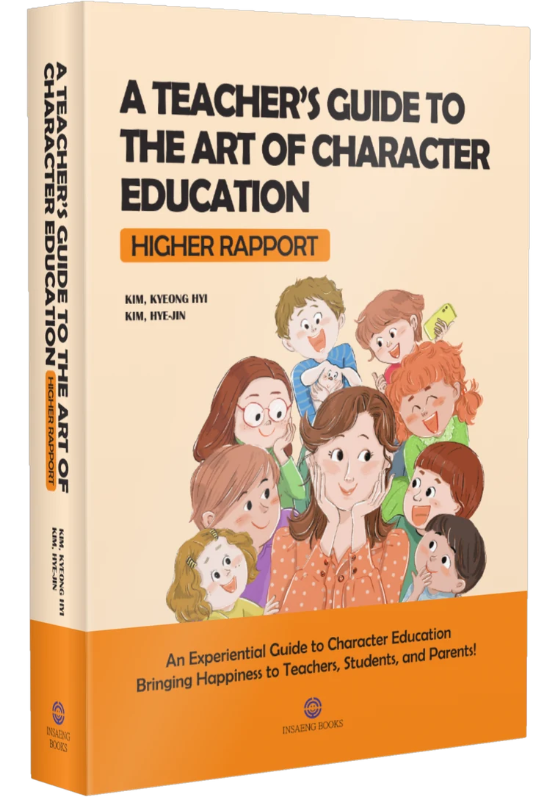

```{=html}
<section class="section" style="padding-top:56px"><div class="wrap"><div class="sec-title"><span class="eyebrow">ABOUT</span><h2>Two teachers who found answers in the classroom</h2><p>The roots of PLUSZONE Education are not in theory but in the classroom. The answers two teachers found through <b>34 and 22 years</b> of working with children became the starting point of this education.</p></div><div class="people"><div class="person"><div class="phead"><div class="pname"><span class="prole">School health teacher, 34 years</span><h3>Kim Kyeong-Hyi</h3></div></div><div class="badges"><span>School Health Teacher</span><span>Bachelor’s Degree in Nursing</span><span>M.Ed. in Educational Counseling</span></div><p>She is dedicated to addressing students’ physical and emotional challenges in the health office, supporting self-reflection and positive behavioral change. She has practiced character education by listening closely to students’ hearts and minds.</p></div><div class="person"><div class="phead"><div class="pname"><span class="prole">Elementary school teacher, 22 years</span><h3>Kim Hye-Jin</h3></div></div><div class="badges"><span>Elementary School Teacher</span><span>M.Ed. in Educational Counseling</span><span>Completed Doctoral Coursework in Education</span></div><p>Based on her firsthand experience in implementing character education, her insightful observations offer refreshing solutions not only to students, parents, colleagues, and early-career teachers, but also to senior educators in the field.</p></div></div></div></section><section class="section"><div class="wrap"><div class="bookband"><div><span class="lbl">The two authors’ classroom record</span><h3>A Teacher’s Guide to the Art of Character Education</h3><span class="en">Higher Rapport · Korean edition: 『인성교육, 참! 잘하는 교사』</span><p class="by">Kim Kyeong-Hyi · Kim Hye-Jin &nbsp;|&nbsp; Insaeng Books &nbsp;·&nbsp; <a href="book.html">About the book →</a></p><blockquote>“There are mistakes in our education, but no failures.”<small>— from the book</small></blockquote></div></div></div></section><section class="section"><div class="wrap"><div class="sec-title"><span class="eyebrow">OUR PHILOSOPHY</span><h2>The joy of growth by choosing PLUS (+)</h2><p>Everyone wants to live happily. PLUSZONE Education helps people <b>discover the minus</b> that creates the gap between who they want to be and who they are now, and experience <b>the joy of choosing plus</b> for themselves.</p></div><div class="note-box"><b>(+,+): the growth of consciousness</b> — Education that shows how your life becomes plus (+) when you meet every thought and way of living actively, proactively and positively.</div></div></section><section class="section"><div class="wrap"><div class="sec-title"><span class="eyebrow">A SINGLE THOUGHT</span><h2>A Single Thought</h2></div><div class="poem"><p>Here is a single thought.<br>A single thought gives rise to a person’s words.<br>A person’s words give rise to their actions.<br>Their actions give rise to their habits.<br>Their habits shape the atmosphere of a place.</p><p>The atmosphere of a place<br>shapes the values and customs<br>of a family, a workplace, and a society.<br>The values and customs of a society<br>shape the history of an era.</p><p>Therefore, ask yourself:<br>What kind of thought are you holding?<br>What kind of words are you speaking?<br>What kind of actions are you taking?<br>Look back and reflect.</p><p>Know that the single thought<br>you are holding at this very moment<br>is shaping your destiny<br>and creating your future and your history.</p><p>With what single thought are you making history?<br>With what single thought<br>are you painting the picture of your life?</p><p>Are you following others and copying their pictures?<br>Or are you painting a picture of your own?<br>Are you painting a picture that is stained and ugly?<br>Or one filled with beauty and grace?<br>Or are you merely dressing it up for appearances?</p><p>With a single thought,<br>I have painted the picture of my life.<br>With clarity and meticulous care,<br>I have shaped every detail of my life —<br>making each and every step<br>joyful and beautiful.</p><p class="sig">written by Sang Dae Lee</p></div></div></section><div class="pz-end"></div>
```

<!-- navy-gold-theme -->
