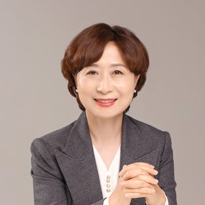
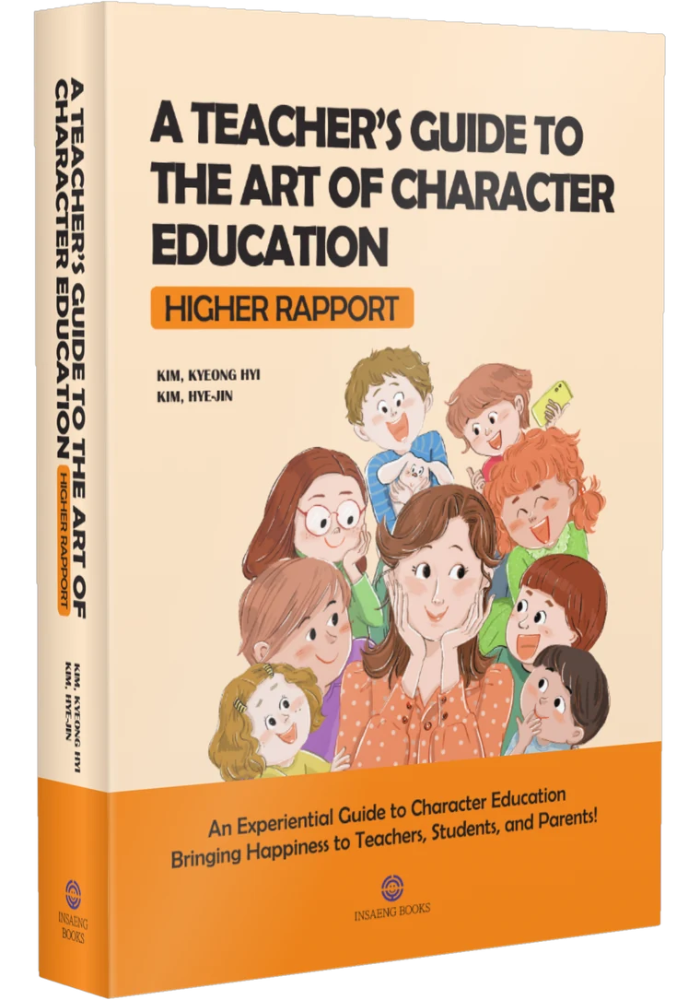

```{=html}
<nav class="ko-subnav" aria-label="한국어 메뉴"><div class="wrap"><a href="korean.html">홈</a><a href="ko-approach.html">교육 방법</a><a href="ko-stories.html">현장 사례</a><a href="ko-book.html" aria-current="page">책·저자</a><a href="https://pluszone-edusolution.app/?lang=ko" target="_blank" rel="noopener">3S 연습실</a><a class="cta" href="ko-contact.html">문의하기</a><a class="lang" href="about.html">English</a></div></nav>
<section class="section" style="padding-top:56px"><div class="wrap"><div class="sec-title"><span class="eyebrow">이 교육을 실천한 사람들</span><h2>현장에서 답을 찾은 교사</h2><p>플러스존 에듀케이션의 뿌리는 이론이 아닌 교실입니다. 두 교사가 <b>34년, 22년의 교직 현장</b>에서 아이들과 부딪히며 찾아낸 답이 이 교육의 출발점이 되었습니다.</p></div><div class="people"><div class="person"><div class="phead"><div class="pname"><span class="prole">34년 차 보건교사</span><h3>김경희</h3><span class=rom>Kim Kyeong-Hyi</span></div></div><div class="badges"><span>보건교사 34년</span><span>간호학</span><span>상담교육 전공</span></div><p>대학에서 간호학을, 대학원에서 상담교육을 전공했다. 보건실을 찾는 아이들의 몸뿐 아니라 마음의 아픔을 돌보며, 생각 하나·마음 하나를 바꾸도록 돕는 인성교육으로 복통·두통 같은 증상으로 약을 찾던 아이가 더 이상 약이 필요 없어질 만큼 회복되는 변화를 여러 차례 경험했다.</p><p>학생의 인성을 교육하려면 교사부터 올바른 인성을 갖춰야 한다는 믿음으로, 오늘도 자신에게 먼저 적용하며 학생과 함께 성장하는 길을 실천하고 있다.</p></div><div class="person"><div class="phead"><div class="pname"><span class="prole">22년 차 초등교사</span><h3>김혜진</h3><span class=rom>Kim Hye-Jin</span></div></div><div class="badges"><span>초등교사 22년</span><span>초등교육학</span><span>교육학 박사과정 수료</span></div><p>교육대학교를 졸업하고 교육상담 석사학위를 취득했으며, 교육학 박사과정을 수료한 교육현장 교육자이다. 행복한 교직 생활을 꿈꿨지만 현실은 녹록지 않았다. 교사에게 욕을 하는 아이들, 과잉보호하거나 방임하는 학부모 속에서 ‘지치지 않고’ 인성교육하는 방법을 찾기 위해 노력해 왔다.</p><p>아이들과의 일을 기록하며 교사·학생·학부모 모두의 인성이 바로 서는 길을 탐구하고, ‘나부터 옳은 사람이 되겠다’는 다짐으로 한 걸음씩 나아가고 있다.</p></div></div></div></section><section class="section"><div class="wrap"><div class="bookband"><div><span class="lbl">두 저자의 현장 기록을 담은 책</span><h3>『인성교육, 참! 잘하는 교사』</h3><span class="en">영문판 A Teacher’s Guide to the Art of Character Education — Higher Rapport</span><p class="by">김경희 · 김혜진 저 &nbsp;|&nbsp; 인생북스 &nbsp;·&nbsp; <a href="ko-book.html">책 소개 보기 →</a></p><blockquote>“우리의 교육에 실수는 있어도 실패가 없는 것이다”<small>— 『인성교육, 참! 잘하는 교사』 중에서</small></blockquote></div></div></div></section><section class="section"><div class="wrap"><div class="sec-title"><span class="eyebrow">운영 철학</span><h2>PLUS(+)를 선택하는 변화의 즐거움</h2><p>누구나 행복하게 살기를 원합니다. 플러스존 에듀케이션은 바라는 나와 지금의 나 사이, 그 간극을 만드는 <b>마이너스를 발견</b>하고 <b>스스로 플러스를 선택하는 즐거움</b>을 경험하도록 돕습니다.</p></div><div class="note-box"><b>(+,+), 의식의 성장</b> — 모든 사고나 생활 방법을 능동적, 적극적, 긍정적으로 대처해 나가면 나의 삶이 어떻게 플러스(+)로 이루어지게 되는지를 알게 되는 교육입니다.</div></div></section><section class="section"><div class="wrap"><div class="sec-title"><span class="eyebrow">A SINGLE THOUGHT</span><h2>여기에 한 생각이 있다</h2></div><div class="thought">한 생각은<br>한 사람의 말을 낳고<br>
한 사람의 말은<br>
한 사람의 행동을 낳고<br>
한 사람의 행동은<br>
한 사람의 습관을 낳고<br>
한 사람의 습관은<br>
한 장소의 분위기를 낳고<br>
한 장소의 분위기는<br>
한 가정 한 직장 한 사회의
가치기준과 한 풍습을 만들고<br>
한 사회의 가치기준과 풍습은
한 시대의 역사를 만들어가는 것이다<br><br>

그러므로 그대는 지금<br>
어떠한 한 생각을 하고 있는가?<br>
어떠한 말을 하고 있는가?<br>
어떠한 행동을 하고 있는가?<br>
돌아보라<br><br>

지금 생각하고 있는 그 한 생각이
사주를 팔자를 만들어가고 있으며<br>
그대의 미래와 역사를
지금 만들어가고 있는 것임을 알라<br><br>

그대는 어떠한 한 생각으로
역사를 만들어가고 있는가?<br>

그대는 어떠한 한 생각으로
그림을 그려가고 있는가?<br><br>

남을 따라 그림을 그려가고 있는가?<br>
본인 자신의 그림을 그려가고 있는가?<br><br>

그대는<br>
더럽고 추한 그림을 그려가고 있는가?<br>
아름답고 향기로운 그림을 그려가고 있는가?<br>
포장만 하며 다니고 있는가?<br><br>

나는 한 생각으로 나의 그림을 그려왔다<br>
구체적이고 세밀하게 내 인생을 그려왔다<br>
발걸음 발걸음마다 즐겁고 아름답게<small>— <i>A Single Thought</i> 중에서 · 이상대</small></div></div></section><div class="pz-end"></div>
```

<!-- navy-gold-theme -->
