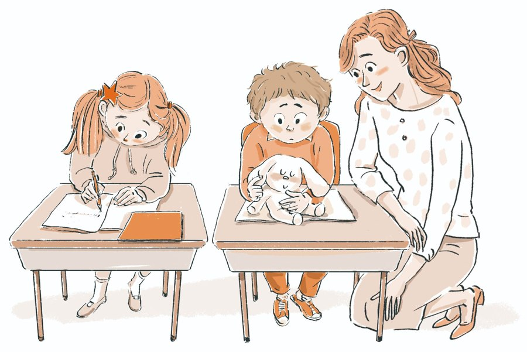
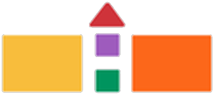

```{=html}
<nav class="ko-subnav" aria-label="한국어 메뉴"><div class="wrap"><a href="korean.html">홈</a><a href="ko-approach.html">교육 방법</a><a href="ko-stories.html">현장 사례</a><a href="ko-book.html">책·저자</a><a href="https://pluszone-edusolution.app/?lang=ko" target="_blank" rel="noopener">3S 연습실</a><a class="cta" href="ko-contact.html">문의하기</a><a class="lang" href="partners.html">English</a></div></nav>
<section class="section" style="padding-top:56px"><div class="wrap"><div class="sec-title"><span class="eyebrow">GLOBAL EDUCATION PARTNERSHIPS</span><h2>플러스존 교육을 함께 연구하고<br>실천할 교육기관과 파트너를 찾습니다</h2></div><div class="areas"><div class="area"><span class="n">1</span><b>교사 연수</b></div><div class="area"><span class="n">2</span><b>교육콘텐츠 공동개발</b></div><div class="area"><span class="n">3</span><b>글로벌 교육 협력</b></div></div></div></section><section class="section"><div class="wrap"><div class="sec-title"><span class="eyebrow">교육 현장에서 시작된 플러스존</span><h2>현장의 경험을 교육의 신뢰로</h2><p>플러스존 에듀케이션은 두 교육자의 오랜 교직 경험과 학생들과의 실제 만남 속에서 발전해 왔습니다. 학생이 스스로 성찰하고 판단하며 실천하도록 돕는 교육방법을 탐구해 왔습니다.</p></div><div class="qr-card"><div><span class="eyebrow">STUDENT STORIES</span><h3>학생의 변화, 실제 사례로 확인하세요</h3><p>학생이 자신의 생각과 행동을 돌아보고 더 나은 선택을 실천해 가는 현장 사례를 확인할 수 있도록 자료를 제공합니다.</p><a class="buy-btn primary" href="ko-stories.html">학생 변화 사례 보기</a></div></div></div></section><section class="wrap" id="expo" data-until="2027-01-30T00:00:00+09:00"><div class="expo"><div class="expo-logo"><span>EDUCATION KOREA 2027</span></div><div><span class="lbl">EXHIBITION PARTICIPATION</span><h3>제24회 대한민국 교육박람회에 <span class="nw">참가합니다</span></h3><i>We will be exhibiting at EDUCATION KOREA 2027</i><dl><dt>DATE</dt><dd>2027. 1. 27 (수) – 29 (금)</dd><dt>VENUE</dt><dd>서울 코엑스(COEX) A &amp; B홀</dd></dl></div></div></section><script>(function(){if(Date.now()>=Date.parse("2027-01-30T00:00:00+09:00")){document.querySelectorAll("[data-until]").forEach(function(e){e.remove()})}})();</script><section class="wrap"><div class="ct-cta"><div><b>함께할 방법이 궁금하신가요?</b><span>연수·협력 문의는 문의 페이지에서 안내해 드립니다.</span></div><a class="buy-btn primary" href="ko-contact.html">문의하기 →</a></div></section><div class="pz-end"></div>
```

<!-- navy-gold-theme -->
