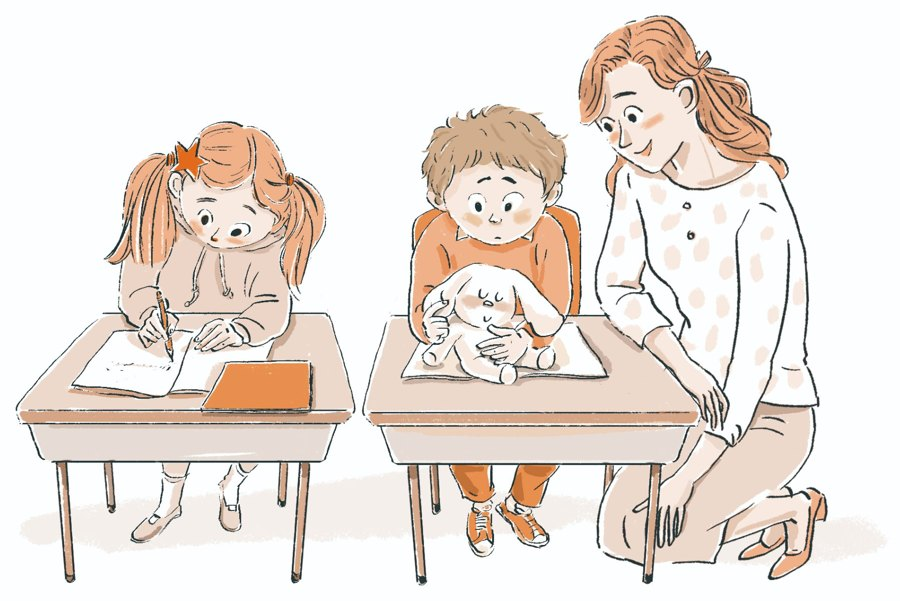

```{=html}
<section class="section" style="padding-top:56px"><div class="wrap"><div class="sec-title"><span class="eyebrow">GLOBAL EDUCATION PARTNERSHIPS</span><h2>We are seeking educational institutions and partners<br>to research and practice PLUSZONE Education together</h2></div><div class="areas"><div class="area"><span class="n">1</span><b>Teacher Training</b></div><div class="area"><span class="n">2</span><b>Joint Development of Educational Content</b></div><div class="area"><span class="n">3</span><b>Global Educational Cooperation</b></div></div></div></section><section class="section"><div class="wrap"><div class="sec-title"><span class="eyebrow">PLUSZONE BEGAN IN EDUCATIONAL SETTINGS</span><h2>Turning Field Experience into Educational Trust</h2><p>PLUSZONE Education has developed through the two educators’ many years of teaching experience and real interactions with students. They have explored educational methods that help students reflect, judge, and act independently.</p></div><div class="qr-card"><div><span class="eyebrow">STUDENT STORIES</span><h3>Student Transformation: Discover Real-Life Case Studies</h3><p>We provide materials presenting real classroom cases in which students reflect on their thoughts and actions and put better choices into practice.</p><a class="buy-btn primary" href="stories.html">See cases of student change</a></div></div></div></section><section class="wrap" id="expo" data-until="2027-01-30T00:00:00+09:00"><div class="expo"><div class="expo-logo"><span>EDUCATION KOREA 2027</span></div><div><span class="lbl">EXHIBITION PARTICIPATION</span><h3>We will be exhibiting at <span class="nw">EDUCATION KOREA 2027</span></h3><i>The 24th Korea Education Expo</i><dl><dt>DATE</dt><dd>Jan. 27 (Wed) – 29 (Fri), 2027</dd><dt>VENUE</dt><dd>COEX Halls A &amp; B, Seoul</dd></dl></div></div></section><script>(function(){if(Date.now()>=Date.parse("2027-01-30T00:00:00+09:00")){document.querySelectorAll("[data-until]").forEach(function(e){e.remove()})}})();</script><section class="wrap"><div class="ct-cta"><div><b>Interested in working together?</b><span>Find training and partnership enquiries on our contact page.</span></div><a class="buy-btn primary" href="contact.html">Contact us →</a></div></section><div class="pz-end"></div>
```

<!-- navy-gold-theme -->
